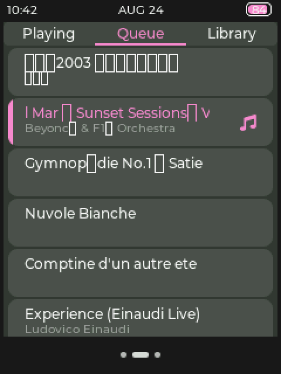
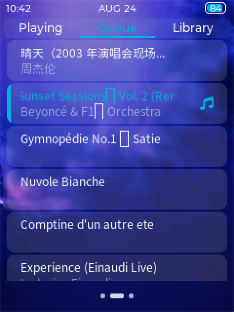
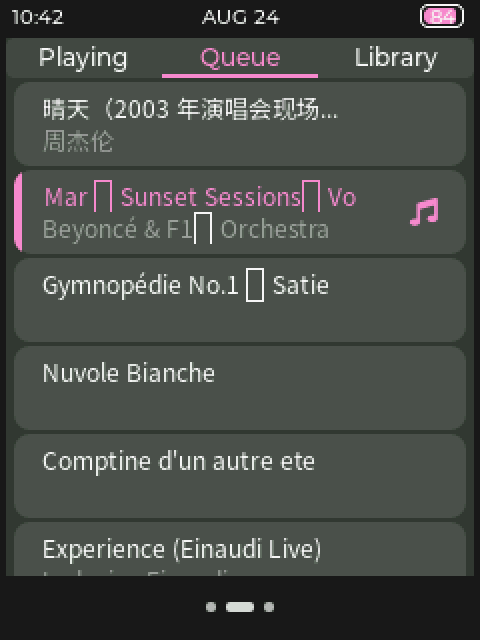
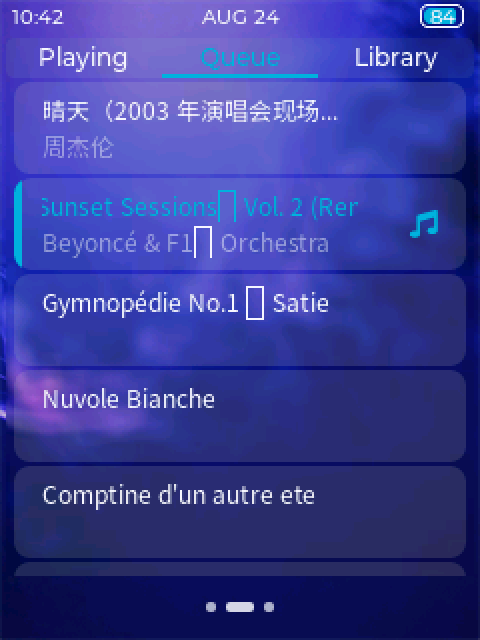
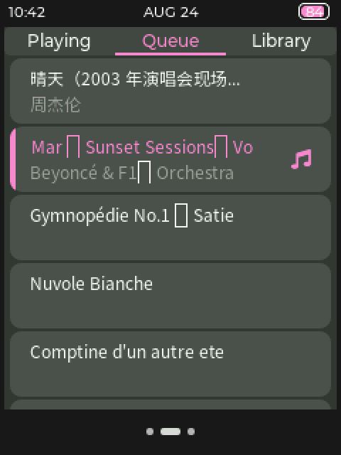
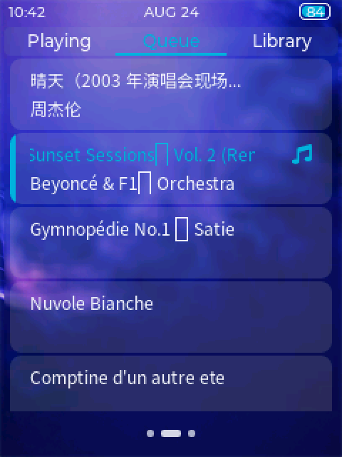
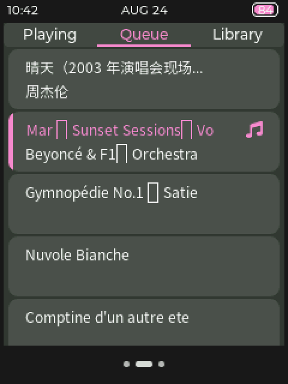

# PROTOTYPE：Queue 行两行排布（#147）

一次性原型，只在 throwaway 分支 `prototype/queue-row-layout`，不合入、不改基线。
问题：Queue 曲名与歌手都改用资源包 Noto 12 px（#145 D 节）后，行高、两行 Y 偏移、间距、歌手 Opa 与右侧符号对齐怎么取。

## 怎么跑

```powershell
cmake -S Tools/gui_simulator -B build/gui_simulator -G Ninja -DCMAKE_C_COMPILER=gcc
cmake --build build/gui_simulator
./build/gui_simulator/gui_simulator.exe --queue-layout 2   # 0=现状 1=A 2=B 3=C
```

截图脚本参数：`--hidden --queue-layout N --drag 6000:120,290:120,80:250 --tap 7500:125,28 --tap 8000:100,<第 2 行中心 Y> --shot 9200:solid --key 9300:t --shot 10200:default`
（模拟器启动为 Solid，按 `t` 切 Default）。stdout 的 `[proto]` 行给出几何。

改动：
- `Service/gui/main/queue/gui_service_main_queue.c`：方案表 `service_gui_main_queue_proto_layouts[]`；方案 1–3 的曲名与歌手都取 `service_gui_font_title()`；打印 `[proto]` 几何。
- `Tools/gui_simulator/sim_script.c`：`--queue-layout N`。
- `Tools/gui_simulator/fakes/storage_sim.c`：位置 0–2 补假标签，首屏四类行。

## 首屏四类行

| 位置 | 标题 | 歌手 | 类别 |
|---|---|---|---|
| 0 | `晴天（2003 年演唱会现场版）` | `周杰伦` | 中文标题 + 中文歌手 |
| 1 | `Café del Mar – Sunset Sessions™ Vol. 2 (Remastered Édition)` | `Beyoncé & F1® Orchestra` | 西文长名，点为当前行后循环滚动 |
| 2 | `Gymnopédie No.1 – Satie` | （无） | 标题无歌手 |
| 3 | `Nuvole Bianche` | （无） | 无标签，回退文件主名 |

`– ™ ® É` 在现有字体 bin 中缺字，画占位框；字集票加入 Latin-1 补充区与 U+2013/U+2122 后消失，与排布无关。`é` 在 GB2312 拼音区，已能显示。

## 方案取值

Y 偏移从 panel 上沿量起。LVGL 8.3 的内容区按四边各减 `border_width`（4 px），即使只画左边条，所以高度 = 2 × 16（Noto 行高）+ 间距 + 2 × pad + 8。QueueTab 内容高 245 px，行间 `pad_row` 2 px。

| 方案 | 行高 | pad 上/下 | 曲名 Y | 歌手 Y | 两行间距 | 歌手 Opa | 右侧符号 | 一屏可见 |
|---|---|---|---|---|---|---|---|---|
| 现状（Montserrat 12/10） | 41（17%） | 1 | 5 | 20 | 0 | 180 | 整行垂直居中（Y 13） | 5 行 + 30 px |
| A 紧凑 | 42 | 1 | 5 | 21 | 0 | 180 | 整行垂直居中（Y 13） | 5 行 + 25 px |
| B 均衡 | 46 | 2 | 6 | 24 | 2 | 180 | 整行垂直居中（Y 15） | 5 行 + 5 px（几乎刚好 5 行） |
| C 宽松 | 50 | 3 | 7 | 27 | 4 | 255 | 与曲名行对齐（Y 7） | 4 行 + 37 px |

（“一屏可见”= 完整行数 + 下一行露出的像素。）

## 截图

| 方案 | Default | Solid |
|---|---|---|
| 现状 |  |  |
| A |  |  |
| B |  |  |
| C |  |  |

## 结论

待用户在 #147 选定。
